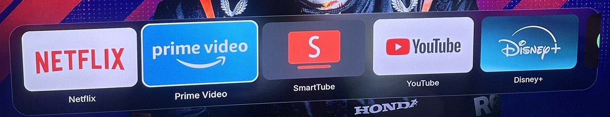
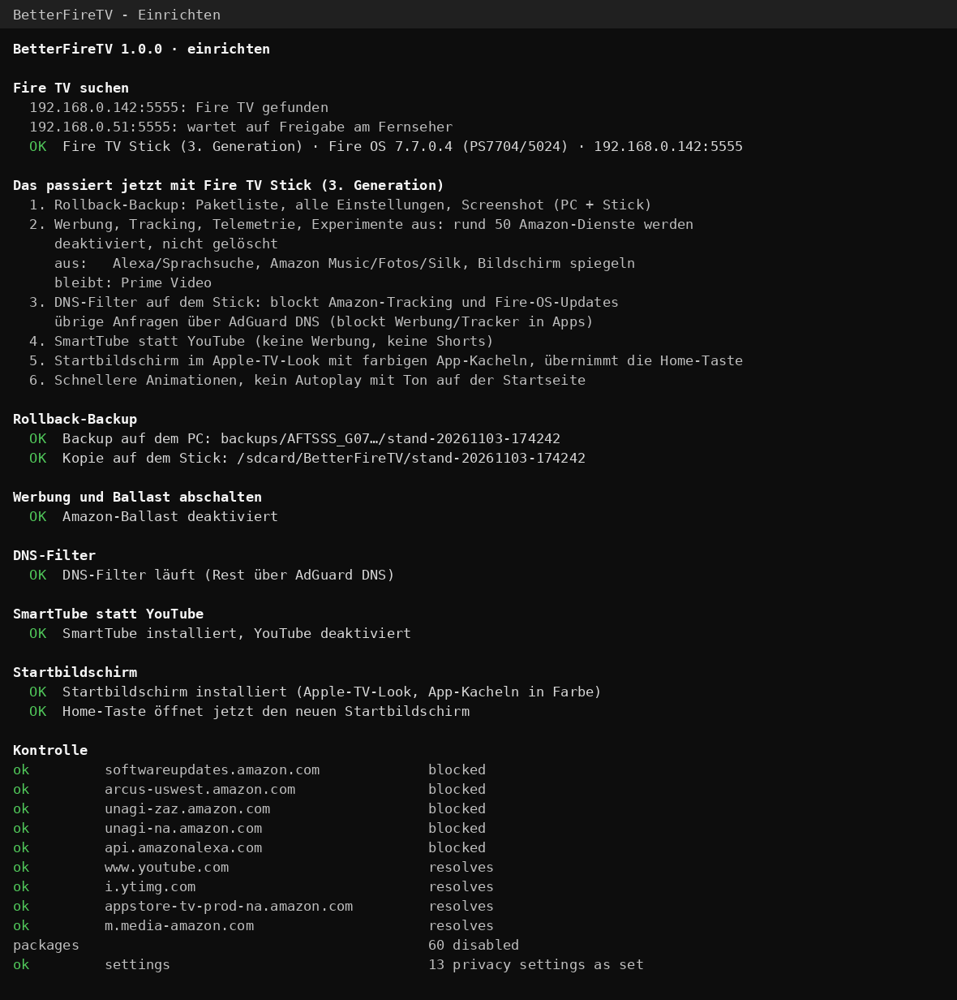

# BetterFireTV

Macht einen Amazon Fire TV Stick werbefrei, spürbar schneller und gibt ihm einen
Startbildschirm im Apple-TV-Look. Ohne Root. Vorher wird alles gesichert, und ein
Doppelklick stellt den alten Zustand wieder her. Gestartet wird es unter Windows per
Doppelklick: Das Tool findet den Stick selbst im WLAN.

> Kein Projekt von Amazon und nicht mit Amazon verbunden. „Fire TV“ ist eine Marke von
> Amazon.com, Inc. oder ihren Tochtergesellschaften.



*Der Startbildschirm: farbige App-Kacheln im Glas-Dock über deinem eigenen Hintergrundbild. Ein
aktuelles Bild davon macht `Screenshot.cmd`.*

<details>
<summary>So sieht das Einrichten am PC aus</summary>



</details>

## Was passiert

| | |
|---|---|
| **Rollback-Backup** | Bevor sich etwas ändert, sichert das Tool Paketliste, alle Einstellungen, Bedienungshilfen, Netzwerkregeln und einen Screenshot. Das Backup landet in `backups/` auf dem PC und als Kopie auf dem Stick unter `/sdcard/BetterFireTV/`. |
| **Werbung und Tracking aus** | Etwa 50 Amazon-Dienste werden deaktiviert, nichts wird gelöscht. Betroffen sind gesponserte Reihen, Werbe-ID, Bildschirmerkennung (ACR), Telemetrie und Experimente. Werbe-Tracking und Nutzungsdaten werden abgeschaltet. |
| **Nach deiner Auswahl** | Zum Beispiel: Prime Video bleibt, Alexa, Amazon Music, Fotos, Silk und Bildschirm-Spiegeln werden abgeschaltet. Festgelegt wird das in `einstellungen.txt`. |
| **DNS-Filter auf dem Stick** | Blockt die Tracking- und Update-Server von Amazon. Alle übrigen Anfragen laufen über AdGuard DNS, das zusätzlich Werbung in Apps blockt. |
| **SmartTube** | Ersetzt die YouTube-App: keine Werbung, keine Shorts, gleiches Google-Konto. |
| **Startbildschirm** | Apple-TV-Look mit Foto, dünner Uhr, Glas-Dock und App-Kacheln in Farbe. Übernimmt die Home-Taste. Basiert auf FireFrame, Quelltext in `home/`. |
| **Schneller** | Kürzere Animationen, kein Autoplay mit Ton und mehr freier Arbeitsspeicher. |

## Einrichten

1. Am Fernseher: **Einstellungen > Mein Fire TV > Entwickleroptionen > ADB-Debugging: an.**
   Den Stick eingeschaltet lassen.
2. PC und Stick müssen im selben WLAN sein. **VPN ausschalten**, denn ein Firmen-VPN
   sperrt oft das Heimnetz.
3. **`Einrichten.cmd`** doppelklicken. Das Tool lädt beim ersten Mal adb und, falls
   nötig, Git Bash herunter und sucht den Stick selbst im Netz. Hängen mehrere Sticks
   im Netz, fragt es, welcher gemeint ist.
4. Am Fernseher erscheint *„USB-Debugging zulassen?“*. Dort **„Immer von diesem
   Computer zulassen“** anhaken und **OK** drücken.
5. Den Plan bestätigen. Das dauert etwa 10 Minuten, der Stick startet dabei 2 bis 3 Mal neu.

Auf Fire OS 8 (z. B. Fire TV Stick 4K, 2. Generation) braucht der DNS-Filter manchmal
einen Handgriff in der App *personalDNSfilter*. Das Tool sagt dann genau, was zu tun ist.

Danach:

- **`Startbildschirm.cmd`** zeigt alle Apps mit Nummern. Dort legst du die Reihenfolge
  im Dock fest (z. B. `3 1 7`) und kannst Apps ausblenden.
- **`Hintergrund.cmd`** öffnet ein Auswahlfenster für eigene Fotos. Sie werden richtig
  gedreht, auf Full HD verkleinert und auf den Stick gebracht. Am Fernseher wechselt das
  Bild-Symbol oben rechts zwischen den Bildern. Wer ein Foto aus `hintergruende/` löscht
  und `Hintergrund.cmd` startet, nimmt es auch vom Stick.
- **SmartTube:** Einstellungen > Allgemein > Shorts ausblenden.
- **Amazon-Einstellungen** erreichst du über das Zahnrad oben rechts.

Am Fernseher selbst geht auch einiges. In der App-Schublade (Raster-Symbol oben
rechts) OK lange drücken, dann „Ins Dock legen“ oder „Ausblenden“ wählen. Über das
Zahnrad lassen sich ausgeblendete Apps wieder zeigen.

**personalDNSfilter** ist der DNS-Filter. Er läuft unsichtbar im Hintergrund und muss
nie geöffnet werden, deshalb ist er im Startbildschirm ausgeblendet. Die App ist für
Handys gebaut und sieht auf dem Fernseher entsprechend gestaucht aus.

## Ältere Sticks mit Fire OS 5

Auf dem Fire TV Stick der 2. Generation (AFTT) und anderen Geräten mit Fire OS 5
lässt Amazon keine einzige App abschalten. Auch die Home-Taste lässt sich dort nicht
übernehmen (am echten Gerät ausprobiert). Das Tool erkennt das und richtet nur ein,
was geht:

- Datenschutz-Einstellungen und schnellere Animationen
- den DNS-Filter: Dafür muss einmal am Fernseher die VPN-Frage mit OK bestätigt werden, das Tool führt hindurch.
- SmartTube: Die Installation dauert dort 5 bis 10 Minuten.

Amazons Startseite bleibt auf diesen Geräten.

## Rückgängig machen

**`Rueckgaengig.cmd`** doppelklicken. Der Stick wird auf den Stand des allerersten
Backups (`backups/<Modell>_<Seriennummer>/original`) zurückgesetzt:

- Alle deaktivierten Apps werden wieder eingeschaltet. YouTube und Amazons Startbildschirm kommen zurück.
- Der Startbildschirm, SmartTube und der DNS-Filter werden entfernt.
- Jede Einstellung, die das Tool geändert hat, bekommt wieder ihren alten Wert.
- Apps, die nach dem Einrichten selbst installiert wurden, bleiben.

Das funktioniert auch von einem anderen PC aus, weil das Backup auch auf dem Stick
liegt. ADB-Debugging muss dafür eingeschaltet sein. Das allerletzte Mittel ist ein
Werksreset (Zurück- und Rechts-Taste 10 Sekunden halten). Danach muss man sich bei
Amazon und in den Apps neu anmelden.

## Alle Knöpfe

| Datei | macht |
|---|---|
| `Einrichten.cmd` | richtet den Stick ein, mit Backup vorab |
| `Rueckgaengig.cmd` | stellt den Stand des Original-Backups wieder her |
| `Startbildschirm.cmd` | legt die Dock-Reihenfolge fest und blendet Apps aus |
| `Hintergrund.cmd` | bringt eigene Fotos als Hintergrund auf den Stick |
| `Status.cmd` | zeigt Startbildschirm, Dock, DNS-Filter, abgeschaltete Pakete und freien Arbeitsspeicher |
| `Backup.cmd` | macht nur ein Backup, ohne etwas zu ändern |
| `Screenshot.cmd` | macht ein sauberes Bild vom Startbildschirm für dieses README (`docs/bilder/startbildschirm.png`), kurz mit NASA-Hintergrund |

Dock, ausgeblendete Apps und Hintergründe werden pro Gerät in
`backups/<Gerät>/startbildschirm.conf` gespeichert. Nach einer Neuinstallation werden
sie automatisch wieder angewendet.

## Gut zu wissen

- **Fire-OS-Updates** sind blockiert, solange der DNS-Filter läuft. So setzt kein
  Amazon-Update das Setup zurück. Für ein Update: erst `Rueckgaengig.cmd`, dann
  updaten, dann wieder `Einrichten.cmd`.
- Taucht nach einem Update wieder Werbung auf, hilft **`Einrichten.cmd` noch einmal**.
  Das Original-Backup bleibt dabei unverändert.
- **YouTube-Werbung** lässt sich per DNS nicht blocken, weil sie von denselben Servern
  kommt wie die Videos. Deshalb SmartTube.
- An `/system` wird nichts geändert. Es gibt keinen Root und keinen Eingriff in den
  Bootloader.
- Auf einem Firmen-Laptop können Richtlinien adb oder Git Bash blockieren. Dann
  am besten einen privaten PC nehmen.

## Für Entwickler

| | |
|---|---|
| `tool/start.ps1` | Windows-Start (PowerShell 5.1): besorgt adb und Git Bash, sucht Geräte mit offenem Port 5555 im Heimnetz und lässt VPN- und virtuelle Adapter aus |
| `tool/betterfiretv.sh` | Starter. Er liest `betterfiretv-core.sh` komplett ein, bevor etwas passiert, damit ein Update einen laufenden Durchgang nicht stört |
| `tool/betterfiretv-core.sh` | Ablauf: Gerätesuche, Backup, dumbtv-Schritte, Startbildschirm, Dock, Hintergründe, Abgleich beim Rückgängigmachen |
| `home/` | Startbildschirm: Java-Quelltext, `build.sh` (ohne Gradle), fertige `betterfiretv-home.apk`. Der Signierschlüssel `home/signing/` liegt nicht im Repo |
| `vendor/dumbtv` | [dumbtv](https://github.com/humblemuzzu/dumbtv), unverändert (Stand in `VENDORED_COMMIT.txt`) |
| `tests/run.sh` | Ende-zu-Ende-Test gegen einen simulierten Fire TV (Fire OS 8 und Fire OS 5): Einrichten, Dock, Hintergrund, Screenshot, Rückgängig. Danach muss der Stick exakt wieder im Ausgangszustand sein |

```sh
bash tests/run.sh          # braucht bash und python3 (Linux, WSL oder Git Bash)
bash home/build.sh         # baut die APK, siehe home/README.md
```

## Woher die Teile kommen

| Teil | Quelle | Lizenz |
|---|---|---|
| Debloat, Sperren, DNS-Filter-Setup, SmartTube, Restore | [dumbtv](https://github.com/humblemuzzu/dumbtv) | MIT |
| Startbildschirm | eigene Fassung von [FireFrame](https://github.com/dyascj/FireFrame) 1.1.3 | MIT |
| DNS-Filter-App | [personalDNSfilter](https://github.com/IngoZenz/personaldnsfilter) über F-Droid, mit Prüfsumme | GPL-2.0 |
| YouTube-Ersatz | [SmartTube](https://github.com/yuliskov/SmartTube), mit Prüfsumme | eigene Lizenz des Projekts |
| Werbe-DNS | [AdGuard DNS](https://adguard-dns.io) `94.140.14.14`, `94.140.15.15` | Dienst |
| Windows-Start, Gerätesuche, Backup, Rollback, Startbildschirm-Änderungen | dieses Projekt | MIT, siehe `LICENSE` |

## Ordner

```
Einrichten.cmd  Rueckgaengig.cmd  Startbildschirm.cmd  Hintergrund.cmd  Status.cmd  Backup.cmd  Screenshot.cmd
einstellungen.txt     deine Auswahl
tool/                 start.ps1 (Windows), betterfiretv.sh + betterfiretv-core.sh (Ablauf)
home/                 Startbildschirm: Quelltext, build.sh, fertige APK
tests/                Test gegen einen simulierten Fire TV
docs/bilder/          Bilder für diese Seite
vendor/               dumbtv und das Original-FireFrame (nur Lizenz und Doku)

Nicht im Repo (entsteht lokal):
backups/              Backups pro Gerät
logs/                 Protokoll jedes Laufs
hintergruende/        deine Hintergrundbilder
tools/, downloads/    adb, Git Bash und APKs
home/signing/         Signierschlüssel des Startbildschirms
```
